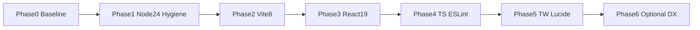

# Parkour Syria — Corrected Modernization Plan (Second-Pass Verification)

**Research / re-verification date:** 2026-10-18  
**Method:** Independent `npm view` of exact versions + official release/security pages. No installs, builds, or file mutations.  
**Constraint:** React remains the UI framework; SPA architecture and `base: '/parkour/'` preserved.

---

## 1. Corrections to the Original Report

| Original claim | Correction | Evidence |
|---|---|---|
| Pin **Node 22** LTS | Pin **Node 24** LTS instead | As of 2026-10-18: Node **24 = Active LTS** (Maintenance from 2026-10-20, EOL 2028-04-30); Node **22 = Maintenance LTS** (EOL 2027-04-30). Local **Node 25 is EOL**. Sources: [nodejs/Release](https://github.com/nodejs/Release), [nodejs.org download](https://nodejs.org/en/download/current) |
| Target **Vite 7.3.7** primarily to “avoid Rolldown” | Target **Vite 8.3.4** as primary | Vite `latest` = **8.3.4** (regular patches). This repo’s [`vite.config.ts`](vite.config.ts) has no `rollupOptions` / `manualChunks` / `esbuild` overrides — Rolldown migration surface is small. `@vitejs/plugin-react@6.1.2` requires only `vite@^8`; Babel/Oxc/compiler peers are **optional**. Vite 7.3.7 remains the **rollback** target if 8 fails verification, not the preferred landing. Sources: [npm vite](https://www.npmjs.com/package/vite), [Vite Releases](https://vite.dev/releases), [Migration from v7](https://vite.dev/guide/migration) |
| `@vitejs/plugin-react` **5.1.4** | Use **6.1.2** with Vite 8 | `5.1.4` peers Vite `^4–^7` only; `6.1.2` peers Vite `^8` |
| “ESLint 9 latest or 10” left ambiguous | Pin **eslint@9.39.5** + **@eslint/js@9.39.5** | npm `maintenance` tag for both is **9.39.5**; `latest` ESLint is **10.13.0** (optional later). Peer-compatible with typescript-eslint 8.71.2 |
| Implied Vite 5.4.8 only as “unsupported” | Also note **5.4.8 &lt; 5.4.21** (latest 5.4 patch) | Patching to 5.4.21 alone is insufficient — Vite 5 line is out of supported security backports |
| Security framing slightly overstated as urgent production risk | Refine: confirmed advisories on **5.4.8** are mostly **dev/preview server** with **`--host` / network exposure** | See Section 4 |
| React **19.3.1** | **Confirmed** | `dist-tags.latest = 19.3.1`, published 2026-10-14T16:47:15Z via `npm view` |

**Unchanged (still correct after recheck):** React 19 upgrade is appropriate; Tailwind stay on **3.4.19** (v3-lts); TypeScript stay on **5.9.3** (not 7); remove unused Supabase; move `@types/three` to devDependencies; replace hooks ESLint RC with **7.1.1**; lucide → **1.59.0**; preserve SPA + `/parkour/` + `.htaccess`.

---

## 2. Verified Package Version Table

All “Latest Stable” / “Exists?” values from `npm view` on **2026-10-18**. Installed versions: **N/A** (`node_modules` absent).

| Package | Locked now | Latest stable (npm) | Confirmed exists | Recommended target | Engines / peers (verified) | Action |
|---|---|---|---|---|---|---|
| react | 18.3.1 | **19.3.1** (`latest`) | Yes | **19.3.1** | `node >=0.10.0` | Update |
| react-dom | 18.3.1 | **19.3.1** | Yes | **19.3.1** | peer `react@^19.3.1` | Update with react |
| @types/react | 18.3.11 | **19.3.0** | Yes | **19.3.0** | — | Update with React 19 |
| @types/react-dom | 18.3.0 | **19.3.0** | Yes | **19.3.0** | peer `@types/react@^19.3.0` | Update with React 19 |
| vite | **5.4.8** | **8.3.4** (`latest`); also 7.3.7, 6.4.4 (`previous`) | Yes | **8.3.4** | `^20.19.0 \|\| >=22.12.0`; optional peers only | Update |
| @vitejs/plugin-react | 4.3.2 | **6.1.2** | Yes | **6.1.2** | peer `vite@^8`; oxc/babel/compiler **optional** | Update with Vite 8 |
| typescript | 5.6.3 | **7.0.2** (`latest`); **5.9.3** latest 5.x | Yes | **5.9.3** | TS7 blocked by typescript-eslint peer `<6.1.0` | Update within 5.x |
| typescript-eslint | 8.8.1 | **8.71.2** | Yes | **8.71.2** | `eslint ^8.57\|\|^9\|\|^10`; `typescript >=4.8.4 <6.1.0` | Update |
| eslint | 9.12.0 | **10.13.0** (`latest`); **9.39.5** (`maintenance`) | Yes | **9.39.5** | ESLint 10 engines need Node `^20.19\|\|^22.13\|\|>=24` | Update on 9 maintenance |
| @eslint/js | 9.12.0 | **10.0.1** / **9.39.5** maint. | Yes | **9.39.5** | peer eslint ^10 for 10.x package | Match eslint 9.39.5 |
| eslint-plugin-react-hooks | **5.1.0-rc-…** | **7.1.1** (`latest`) | Yes | **7.1.1** | eslint ^3–^10 | Replace RC |
| eslint-plugin-react-refresh | 0.4.12 | **0.5.7** | Yes | **0.5.7** | peer `eslint ^9 \|\| ^10` | Update |
| globals | 15.11.0 | **17.13.0** | Yes | **17.13.0** | node >=18 | Update |
| tailwindcss | 3.4.17 | **4.3.3** (`latest`); **3.4.19** (`v3-lts`) | Yes | **3.4.19** | — | Stay on v3-lts |
| postcss | 8.4.47 | **8.5.30** | Yes | **8.5.30** | — | Update |
| autoprefixer | 10.4.20 | **10.6.1** | Yes | **10.6.1** | peer postcss ^8.1 | Update (needed for TW3) |
| lucide-react | 0.446.0 | **1.59.0** | Yes | **1.59.0** | peer react `^16.5\|\|^17\|\|^18\|\|^19` | Update |
| three | 0.186.1 | **0.186.1** | Yes | **0.186.1** | — | Keep |
| @types/three | 0.186.0 | **0.186.0** | Yes | **0.186.0** (devDep) | — | Keep + relocate |
| @supabase/supabase-js | 2.57.4 | **2.118.0** | Yes | **remove** | Unused in source | Remove |

**Node / npm (environment, not npm packages)**

| Item | Verified | Recommendation |
|---|---|---|
| Local Node | **v25.8.0** (EOL odd line) | Do not use as project standard |
| Local npm | **11.11.0** | Fine with Node 24 |
| Node 22 | Maintenance LTS, EOL **2027-04-30** | Acceptable short-term; shorter runway |
| Node 24 | Active LTS → Maintenance **2026-10-20**, EOL **2028-04-30** | **Project pin: 24** (e.g. `.nvmrc` → `24`) |
| Node 26 | Current → Active LTS **2026-10-28** | Too new for default pin this week; revisit later |
| Vite / plugin-react engines | `^20.19.0 \|\| >=22.12.0` | Satisfied by Node **24** |

Sources: [npm react](https://www.npmjs.com/package/react), [npm vite](https://www.npmjs.com/package/vite), [npm @vitejs/plugin-react](https://www.npmjs.com/package/@vitejs/plugin-react), [npm typescript](https://www.npmjs.com/package/typescript), [npm tailwindcss](https://www.npmjs.com/package/tailwindcss), [npm eslint](https://www.npmjs.com/package/eslint), [nodejs/Release](https://github.com/nodejs/Release), [typescript-eslint dependency versions](https://typescript-eslint.io/users/dependency-versions).

---

## 3. Compatibility Matrix (Proposed Target Stack)

| Pairing | Status | Basis | Needs install/build to confirm? |
|---|---|---|---|
| react@19.3.1 + react-dom@19.3.1 | Compatible | Matching versions; peer exact | Runtime smoke |
| React 19 + @types/react(-dom)@19.3.0 | Compatible | Registry peers | `tsc` |
| vite@8.3.4 + @vitejs/plugin-react@6.1.2 | Compatible | peer `vite@^8`; optional extras | **Build required** |
| vite@8.3.4 + Node 24 | Compatible | engines `>=22.12.0` | Dev server |
| typescript@5.9.3 + typescript-eslint@8.71.2 | Compatible | peer `<6.1.0` | Lint |
| eslint@9.39.5 + typescript-eslint@8.71.2 | Compatible | peer includes ^9 | Lint |
| eslint@9.39.5 + hooks@7.1.1 + refresh@0.5.7 | Compatible | peers include ^9 | Lint |
| lucide-react@1.59.0 + react@19 | Compatible | peer includes ^19 | Visual icon check |
| tailwindcss@3.4.19 + postcss@8.5.30 + autoprefixer@10.6.1 | Compatible | Same TW3 PostCSS model as today | Visual CSS |
| three@0.186.1 + @types/three@0.186.0 | Compatible | Already current | Liquid hover |
| typescript@7.0.2 + typescript-eslint@8.71.2 | **Incompatible** | peer `<6.1.0`; runtime refuse | Do not pair |
| @vitejs/plugin-react@5.1.4 + vite@8 | **Incompatible** | peer max ^7 | Do not pair |
| vite@8 + base `/parkour/` | Expected OK | Config API unchanged for `base` | **Build + preview + Apache refresh** |
| Vite 8 Rolldown + this codebase | **Unverified** | Minimal config reduces risk; CJS interop possible | **Production build** |

---

## 4. Updated Security Findings

### Confirmed applicable to locked `vite@5.4.8`

| Advisory | Severity | Affected range includes 5.4.8? | Preconditions | Production static Apache impact |
|---|---|---|---|---|
| [CVE-2025-32395](https://www.cve.org/CVERecord?id=CVE-2025-32395) / GHSA-356w-63v5-8wf4 | Medium | **Yes** (`>=5.0.0 <5.4.18`) | Dev server on Node/Bun + **network exposure** (`--host` / `server.host`) | **No** (built `dist/` not Vite server) |
| [GHSA-jqfw-vq24-v9c3](https://github.com/vitejs/vite/security/advisories/GHSA-jqfw-vq24-v9c3) (CVE-2025-58752) | **Low** | **Yes** (`<=5.4.19`) | Dev **or preview** + network exposure + SPA/MPA | **No** for Apache static hosting |

### Maintenance / support risk (not a single CVE)

- Vite **5** is **outside** the supported backport windows ([Vite Releases](https://vite.dev/releases): support on 8.3 / 7.3 / 8.2 / 6.4 / 8.1). Staying on 5.4.8 means **no future security backports**.
- Even on the dead 5.4 line, **5.4.21** exists; locked **5.4.8** is behind patches — upgrading only within 5.4 is a stopgap, not the plan.

### Does not apply to this CSR SPA

- React **Server Components / Server Functions** advisories ([React security advisories](https://github.com/react/react/security/advisories/)) — this app uses `createRoot` only; no RSC.

### Corrected remediation stance

- **Category A:** Leave unsupported Vite 5 → **Vite 8.3.4** (supported current line).
- Do **not** treat Apache-hosted production as currently compromised by the Vite dev-server CVEs above.
- Do **not** claim the application is “secure” from dependency review alone.

---

## 5. Reassessed Dependency Decisions

| Recommendation | Verdict | Classification |
|---|---|---|
| Remove `@supabase/supabase-js` | **Essential cleanup** — zero imports/env/client | B |
| Move `@types/three` → `devDependencies` | **Essential hygiene** | B |
| Replace hooks ESLint RC → **7.1.1** | **Essential** — RC inappropriate | B |
| lucide-react → **1.59.0** | **Recommended** — React 19 peer OK; visual smoke needed | B |
| Stay Tailwind **3.4.19** (defer 4.3.3) | **Correct** — large custom `@layer` CSS; v4 needs CSS-first config + visual regression ([Upgrade guide](https://tailwindcss.com/docs/upgrade-guide)) | D (defer major) |
| Target Vite **8.3.4** (not 7) | **Corrected primary** — support cadence + simple config; verify Rolldown build | B |
| TypeScript **5.9.3** (defer 7.0.2) | **Correct** — eslint peer wall | D (defer TS7) |
| Package rename / README / `.nvmrc` | Rename+README optional; **`.nvmrc` + engines essential** with Node 24 | B (pin) / C (rename, docs) |
| Prettier / Vitest / CI / Dependabot | **Optional separate decisions** — not required for stack health | C |

---

## 6. Preserve Existing Application Behavior

| Behavior | Risk from proposed stack | Verification |
|---|---|---|
| CSR React SPA (`createRoot`, StrictMode) | React 19 Strict Mode double-invokes effects/refs more aggressively | Smoke: Preloader, CustomCursor, Reveal, LiquidImage, HeroSlider |
| Custom History router (`pushState` / `popstate`) | Unaffected by Vite/React majors if client APIs unchanged | Nested URLs + back button |
| `base: '/parkour/'` | Must remain in [`vite.config.ts`](vite.config.ts) | Built asset URLs + `import.meta.env.BASE_URL` |
| Apache SPA fallback [`.htaccess`](public/.htaccess) | Deploy artifact must still ship rewrite | Hard refresh `/parkour/blog/:id` etc. |
| Tailwind + [`src/index.css`](src/index.css) custom layers | Stay on TW3 → low risk | Spot-check dark/light sections, buttons |
| Three.js liquid effect | Keep 0.186.1; Vite 8 may change dep optimize | First hover on gallery; reduced-motion path |
| Scripts (`dev`/`build`/`lint`/`preview`/`typecheck`) | Should keep working | Run after each phase |
| `optimizeDeps.exclude: ['lucide-react']` | May be obsolete after upgrades | Revisit; remove if unnecessary |

---

## 7. Recommended Target Stack (Corrected)

```text
Node.js:     24.x LTS (.nvmrc = 24; engines.node = ^24.0.0 or >=24)
npm:         ship with Node 24
React:       19.3.1 + react-dom 19.3.1
Types:       @types/react 19.3.0 + @types/react-dom 19.3.0
Build:       vite 8.3.4 + @vitejs/plugin-react 6.1.2
Language:    typescript 5.9.3
Styles:      tailwindcss 3.4.19 + postcss 8.5.30 + autoprefixer 10.6.1
Icons:       lucide-react 1.59.0
Graphics:    three 0.186.1 + @types/three 0.186.0 (devDependency)
Lint:        eslint 9.39.5 + @eslint/js 9.39.5 + typescript-eslint 8.71.2
             + eslint-plugin-react-hooks 7.1.1 + eslint-plugin-react-refresh 0.5.7
             + globals 17.13.0
Remove:      @supabase/supabase-js
Preserve:    base '/parkour/', custom router, .htaccess, SPA architecture, React
Defer:       Tailwind 4, TypeScript 6/7, ESLint 10, Node 26, Vite 7 as target,
             backends, Prettier/Vitest/CI unless separately approved
```

### Why this coherent stack (Node 24 + Vite 8)

- **Node 24** is the current LTS line with support through **2028-04-30**; Node 22 EOL is earlier (**2027-04-30**); local Node 25 is EOL. Vite 8 engines accept `>=22.12.0`, so 24 fits without forcing Node 20.
- **Vite 8.3.4** is the npm `latest` line receiving regular patches. Preferring Vite 7 only to avoid Rolldown is not justified for this **minimal** config; preferring Vite 8 without verification would also be wrong — hence Phase 2 acceptance criteria and rollback to **7.3.7 + plugin-react 5.1.4** if build/runtime fails.
- **ESLint 9.39.5** (maintenance) avoids an extra ESLint 10 migration in the same pass while remaining fully supported with typescript-eslint 8.71.2.

---

## 8. Phased Implementation Plan (Corrected — Do Not Execute Yet)



### Phase 0 — Baseline (after approval)
- **Objective:** Know current green/red before upgrades.
- **Changes:** none.
- **Prereq:** Install/use **Node 24** locally for the project (even before `.nvmrc` lands).
- **Verify:** `npm ci`, `npm run typecheck`, `npm run lint`, `npm run build`.
- **Risk / effort:** low / small.
- **Rollback:** N/A.

### Phase 1 — Node pin + hygiene
- **Objective:** Reproducible runtime; remove dead weight.
- **Changes:** `.nvmrc` → `24`; `engines.node` → `^24.0.0` (or `>=24 <25`); remove `@supabase/supabase-js`; move `@types/three` to `devDependencies`; optional rename `package.json` name → `parkour-syria`.
- **Risk / effort:** low / small.
- **Acceptance:** `node -v` is 24.x; `npm ci` succeeds; typecheck/lint/build pass.
- **Rollback:** restore `package.json` / lockfile commit.

### Phase 2 — Vite 5.4.8 → 8.3.4
- **Objective:** Supported build toolchain; keep deployment contract.
- **Changes:** `vite@8.3.4`, `@vitejs/plugin-react@6.1.2`; keep `base: '/parkour/'`, alias `@`, React plugin; review `optimizeDeps.exclude`.
- **Risk / effort:** medium / medium (Rolldown/CJS).
- **Acceptance:** production build succeeds; assets prefixed `/parkour/`; `preview` + nested route refresh OK; no console errors on home/directory/gallery.
- **Rollback:** `vite@7.3.7` + `@vitejs/plugin-react@5.1.4` (supported important+security line), or prior lockfile.
- **Sources:** [Migration from v7](https://vite.dev/guide/migration), [Vite Releases](https://vite.dev/releases).

### Phase 3 — React 18.3.1 → 19.3.1
- **Objective:** Current React stable + matching types.
- **Changes:** react, react-dom, @types/react, @types/react-dom → 19.3.x.
- **Risk / effort:** medium / small–medium.
- **Acceptance:** typecheck clean; smoke routes + animations under StrictMode.
- **Rollback:** 18.3.1 + types 18.x.
- **Source:** [React 19 Upgrade Guide](https://react.dev/blog/2024/04/25/react-19-upgrade-guide).

### Phase 4 — TypeScript + ESLint
- **Objective:** Supported language tooling without TS 7 dual-package complexity.
- **Changes:** typescript@5.9.3; typescript-eslint@8.71.2; eslint@9.39.5; @eslint/js@9.39.5; eslint-plugin-react-hooks@7.1.1; eslint-plugin-react-refresh@0.5.7; globals@17.13.0.
- **Risk / effort:** low–medium / small–medium (new rule noise).
- **Acceptance:** lint + typecheck clean or approved exceptions only.
- **Rollback:** prior lockfile.

### Phase 5 — Tailwind patch + lucide + CSS toolchain
- **Objective:** Stay on TW3 LTS; refresh icons/CSS deps.
- **Changes:** tailwindcss@3.4.19; postcss@8.5.30; autoprefixer@10.6.1; lucide-react@1.59.0.
- **Risk / effort:** low / small.
- **Acceptance:** visual spot-check icons and section styles; build OK.
- **Rollback:** prior versions.

### Phase 6 — Optional DX (only if approved)
- Minimal README (Node 24, scripts, `/parkour/` deploy).
- Prettier / CI / Dependabot / Vitest — **separate decisions**, not automatic.

---

## 9. Claims That Remain Unverified (Require Later Testing)

- Whether `npm ci` + current lockfile already typechecks/lints/builds cleanly.
- Whether Vite **8** Rolldown changes output or breaks any CJS interop in this tree.
- Whether `optimizeDeps.exclude: ['lucide-react']` still helps or hurts.
- Exact ESLint rule deltas from 9.12 → 9.39.5 and hooks RC → 7.1.1.
- React 19 Strict Mode effect double-invoke side effects in Preloader / liquid / cursor.
- Apache production behavior after rebuild (only previewable with real host or local Apache).
- Full `npm audit` / OSV results after lockfile regeneration.
- Whether any transitive vulnerability remains after upgrades.

---

## 10. Approval Checklist

- [ ] **Node:** pin **24.x LTS** (not 22; not local 25)
- [ ] **Vite:** target **8.3.4** + **@vitejs/plugin-react 6.1.2** (rollback path 7.3.7 documented)
- [ ] **React / React DOM:** **19.3.1** + types **19.3.0**
- [ ] **TypeScript:** **5.9.3** (defer 7.x)
- [ ] **ESLint:** **9.39.5** + matching `@eslint/js` (defer ESLint 10)
- [ ] **Tailwind:** stay **3.4.19** (defer v4)
- [ ] **Remove** `@supabase/supabase-js`
- [ ] **Move** `@types/three` to `devDependencies`
- [ ] **hooks plugin** → **7.1.1**; **lucide** → **1.59.0**
- [ ] **Preserve** `base: '/parkour/'`, custom router, `.htaccess`, SPA/React
- [ ] Optional: package rename, README, Prettier, CI, tests — specify which

---

**Stop.** No implementation until explicit approval of this corrected checklist.
